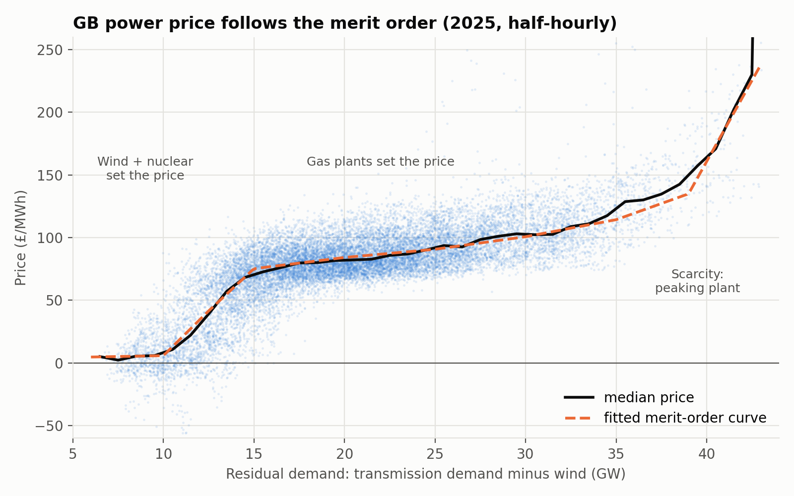
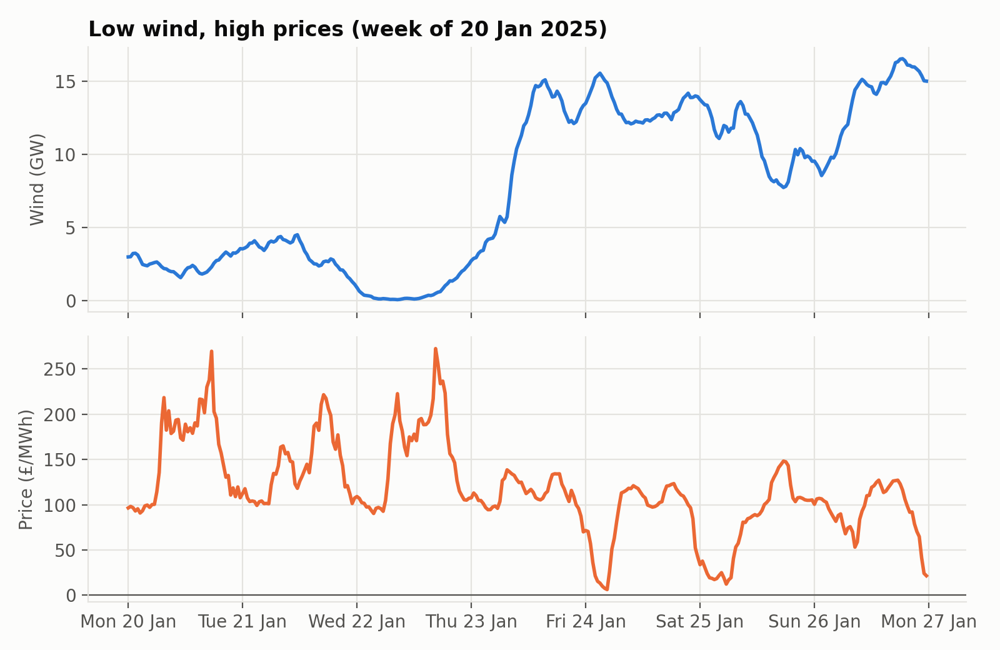
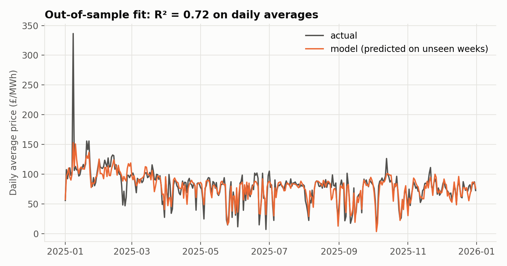

# What sets the UK electricity price?

A fundamentals model of the GB wholesale power price, built from a year (2025) of half-hourly grid data. Price is modelled as a **merit-order curve in residual demand** (national demand minus wind), the same supply-stack logic energy trading desks use.



## Results

| | |
|---|---|
| Data | 17,520 half-hours, 1 Jan – 31 Dec 2025 |
| Mean price | £79.8/MWh |
| Price vs residual demand (correlation) | 0.66 |
| Out-of-sample R² (half-hourly) | **0.55** (vs 0.07 for monthly averages alone) |
| Out-of-sample mean absolute error | **£13.5/MWh** (vs £22.5/MWh) |
| Out-of-sample R² (daily averages) | **0.72** |
| Average price drop per extra GW of wind | **£3.9/MWh** |

- **Three regimes.** Below about 12 GW of residual demand, wind and nuclear can meet almost all demand and the price collapses. 38% of these half-hours had negative prices. Between about 15 and 35 GW, gas plants set the price and the curve is shallow (about £1.3/MWh per GW at 22 GW). Above about 38 GW, expensive peaking plant is needed and the price climbs steeply.
- **Wind matters most at the margin.** An extra GW of wind is worth about £14/MWh off the price when residual demand is around 12 GW, but only about £1/MWh in the middle of the gas regime. Its value depends on what it pushes off the system.
- **What the model misses.** Rare price spikes, such as 8 January 2025, come from short-term system stress (plant outages, interconnector flows, tight margins), not from the demand and wind balance.





## Method

1. **Data** (`get_data.py`). The script downloads half-hourly data from the free [Elexon Insights API](https://data.elexon.co.uk/bmrs/api/v1/swagger/index.html):
   - the market index price (APX)
   - transmission demand outturn
   - generation by fuel type
   - solar estimates
2. **Residual demand.** Residual demand = transmission demand − metered wind. Solar is almost all embedded in the local network, so it already appears as lower transmission demand and isn't subtracted twice.
3. **Model** (`analysis.py`). The model has two parts:
   - a piecewise-linear merit-order curve in residual demand, with knots at 10, 12.5, 15, 20, 25, 30, 35 and 39 GW
   - a level for each month
   
   It is fitted by least absolute deviation, so that a few £1,000+/MWh spikes don't distort the curve.
4. **Gas prices.** Elexon doesn't publish gas prices, so the monthly levels stand in for changes in gas and carbon prices.
5. **Validation.** The model is tested with blocked cross-validation: every fifth week is held out in turn, and each half-hour is predicted by a model that never saw its week. The baseline it's compared against predicts each month's average price.

## Limitations and next steps

- Adding a daily gas price (NBP) as an input would replace the monthly levels and let the model forecast new months.
- Interconnector flows and plant outages would help explain the price spikes.
- The model could be extended to forecast prices from wind and demand forecasts rather than actual outturns.

## Running it

```
pip install -r requirements.txt
python get_data.py     # downloads data/gb_power_2025.csv (a few minutes)
python analysis.py     # fits the model, saves figures/ and results.json
```

Data: Elexon BMRS, used under Elexon's data licence terms.
